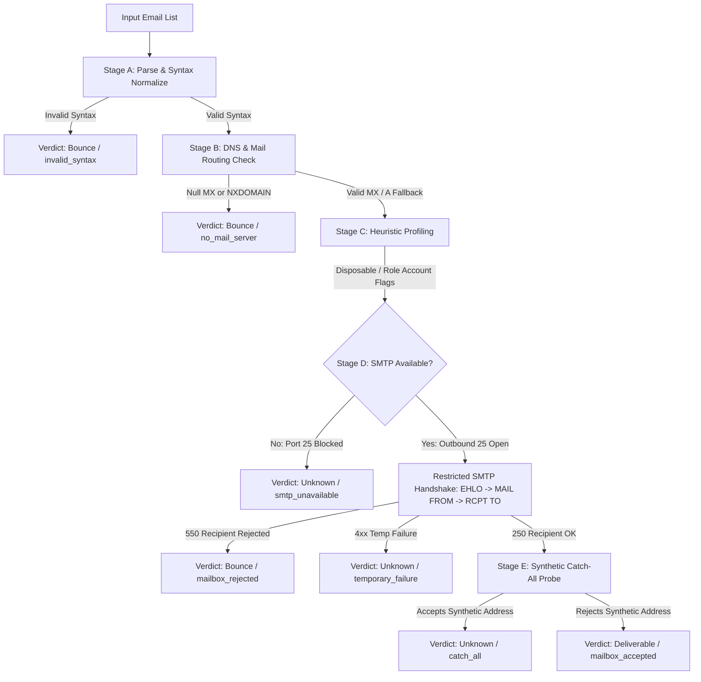

# Email Deliverability Checker

[](https://github.com/PEPSS2007/mailchecker/actions)
[](https://www.python.org/downloads/)
[](https://fastapi.tiangolo.com/)
[](https://opensource.org/licenses/MIT)

A high-accuracy, privacy-first web application and REST API for verifying email deliverability without sending actual emails. Designed for production use as an internship software engineering deliverable.

---

## 🌟 Key Highlights

- **Zero Message Transmission**: Strictly halts SMTP handshakes prior to the `DATA` command. Automated assertions guarantee that no email body is ever transmitted.
- **6-Stage Modular Verification Pipeline**: Syntax validation (RFC 5322), DNS MX records with RFC 7505 Null MX detection, A/AAAA fallback (RFC 5321), disposable/role heuristics, safe async SMTP handshake (RFC 5321), and synthetic catch-all probing.
- **Adaptive Capability Detection (Degraded Mode)**: Automatically senses outbound port 25 blocking (common on Render, Railway, AWS EC2, and consumer ISPs) and transitions gracefully to **DNS-Only Verification** with honest, transparent status indicators.
- **Privacy & SSRF Protection**: In-memory verification with zero database storage of submitted email lists, safe log masking (`j***e@domain.com`), and IP address validation against loopback, private, and link-local ranges.
- **Modern SaaS Dashboard**: Fast, responsive HTML5/CSS3/Vanilla JS frontend with live delimiter parsing, progress tracking, verdict badges, CSV export, and clipboard copy.

---

## 🏗️ Architecture & Verification Pipeline



### Stage Details

1. **Stage A: Parse & Normalize**
   - Supports inputs separated by newlines, commas, semicolons, tabs, and spaces.
   - Enforces domain lowercasing and deduplication while preserving input order.
   - Validates RFC syntax using `email-validator` (enforces max 100 addresses per batch).
2. **Stage B: DNS Verification**
   - Queries DNS MX records with `dnspython`.
   - Detects RFC 7505 Null MX (`0 .`), which declares a domain does not accept email.
   - Implements RFC 5321 fallback to domain `A` or `AAAA` records when MX is absent.
   - Protects against SSRF by validating that mail host IPs do not reside in private/loopback/link-local ranges (`127.0.0.0/8`, `10.0.0.0/8`, `169.254.0.0/16`, etc.).
   - Employs in-memory `TTLCache` (5-minute TTL) for DNS answers.
3. **Stage C: Heuristic Checks**
   - Cross-references a maintainable database of disposable email providers (`app/data/disposable_domains.txt`).
   - Detects role-based accounts (`admin@`, `support@`, `billing@`, `noreply@`, etc.).
   - Adds warning flags without altering canonical verdicts.
4. **Stage D: Safe SMTP Probe**
   - Establishes a TCP connection to the highest-priority MX host on port 25.
   - Executes: `CONNECT` &rarr; `EHLO` &rarr; `MAIL FROM` &rarr; `RCPT TO` &rarr; `QUIT`.
   - Never sends `DATA` or message content.
   - Retries temporary failures (greylisting) at most once with 1-second backoff.
   - Governed by per-domain concurrency semaphores (`asyncio.Semaphore(2)`) to avoid server throttling.
5. **Stage E: Catch-All Detection**
   - Generates an unambiguously randomized recipient (e.g. `antigravity-probe-9b4e1f72a8c3@domain.com`).
   - If the server accepts the fake mailbox with code 250, the domain is classified as `catch_all`.
   - Caches catch-all outcomes per domain in a 10-minute TTL cache.
6. **Stage F: Classification**
   - Standardizes outcomes into exact verdicts: `deliverable`, `bounce`, and `unknown`.
   - Attaches machine-readable reason codes and concise, human-friendly explanations.

---

## 📊 Verdicts & Reason Codes

| Verdict | Reason Code | Description |
| :--- | :--- | :--- |
| **`deliverable`** | `mailbox_accepted` | Destination server explicitly accepted the recipient mailbox with code 250 and is not a catch-all domain. |
| **`bounce`** | `invalid_syntax` | Email address does not conform to RFC 5322 syntax rules. |
| **`bounce`** | `no_mail_server` | Domain does not exist (NXDOMAIN), publishes RFC 7505 Null MX, or lacks MX and A fallback records. |
| **`bounce`** | `mailbox_rejected` | Destination server permanently rejected the recipient mailbox (code 550–554; user unknown or mailbox disabled). |
| **`unknown`** | `catch_all` | Destination server accepts all incoming addresses; individual mailbox validity cannot be confirmed. |
| **`unknown`** | `smtp_unavailable` | Outbound SMTP (port 25) is blocked by the host platform; syntax and DNS are valid, but mailbox check is inconclusive. |
| **`unknown`** | `temporary_failure` | Destination mail server returned a temporary error (greylisting, rate limiting, or server busy). |
| **`unknown`** | `server_unresponsive` | Connection to the destination mail exchanger timed out or failed to connect. |
| **`unknown`** | `provider_hides_status`| Destination provider (e.g. Yahoo, AOL) defers recipient validation or accepts all incoming messages at border gateways. |

---

## 🚀 Quickstart: Local Development

### Prerequisites

- Python 3.12+ (or Python 3.14)
- Git

### 1. Clone & Set Up Virtual Environment

```bash
git clone https://github.com/PEPSS2007/mailchecker.git
cd mailchecker

# Create virtual environment
python -m venv .venv

# Activate virtual environment
# Windows (PowerShell):
.venv\Scripts\Activate.ps1
# macOS / Linux:
source .venv/bin/activate

# Install dependencies
pip install -r requirements.txt
```

### 2. Run the Development Server

```bash
uvicorn app.main:app --reload --host 0.0.0.0 --port 8000
```

Open [http://localhost:8000](http://localhost:8000) in your browser to access the SaaS dashboard.
Open [http://localhost:8000/docs](http://localhost:8000/docs) for the interactive Swagger OpenAPI documentation.

---

## 🐳 Docker Deployment

A lightweight, multi-stage Dockerfile based on `python:3.12-slim` is provided.

### Build and Run with Docker

```bash
# Build Docker image
docker build -t mailchecker:latest .

# Run container (binds to port 8000)
docker run -p 8000:8000 --name mailchecker-app mailchecker:latest
```

The container automatically reads the `PORT` environment variable (defaulting to 8000) and executes under an unprivileged `appuser` for security.

---

## 🌐 Deploying to Render (Step-by-Step)

Render is an ideal deployment platform for this containerized service. Follow these steps:

1. **Push your code to GitHub**:
   ```bash
   git init
   git add .
   git commit -m "feat: complete email deliverability checker application"
   git branch -M main
   git remote add origin https://github.com/PEPSS2007/mailchecker.git
   git push -u origin main
   ```
2. **Log into Render** ([render.com](https://render.com)) and click **New +** &rarr; **Web Service**.
3. **Connect your GitHub repository**: Select `mailchecker`.
4. **Configure Service Details**:
   - **Name**: `email-deliverability-checker`
   - **Region**: Oregon (US West) or Frankfurt (EU Central)
   - **Runtime**: **Docker** (Render detects the root `Dockerfile` automatically)
   - **Instance Type**: Free or Starter
5. **Environment Variables**:
   - `PORT`: Automatically injected by Render (handled dynamically by our `CMD`).
   - `LOG_LEVEL`: `INFO`
6. **Click "Deploy Web Service"**:
   - Render pulls the repository, builds the multi-stage Docker image, and launches the container.
7. **Verify Live Deployment**:
   - Open your Render URL (e.g. `https://mailchecker-service.onrender.com`).
   - Test the health endpoint:
     ```bash
     curl https://mailchecker-service.onrender.com/api/health
     ```

### ⚠️ SMTP Availability on Render (Degraded Mode Notice)

> **Important Deployment Note**: Free and standard tiers of most modern cloud hosting providers (including Render, Railway, AWS EC2, and Heroku) block outbound connections to TCP port 25 to prevent spam abuse.
>
> Our application **gracefully accommodates this**:
> - The application automatically probes outbound port 25 upon startup.
> - When port 25 is blocked, `/api/health` reports `smtp_available: false` and `mode: "dns_only"`.
> - The UI displays a clear **"DNS-Only Degraded Mode"** status banner.
> - Invalid syntax and broken domains still report `bounce`, while valid domains report honest `unknown` statuses with the reason code `smtp_unavailable`.
> - **We never fabricate fake verification results.**

---

## 🔌 API Reference

### 1. Health & Capability Check

```http
GET /api/health
```

#### Response Example (200 OK)
```json
{
  "status": "healthy",
  "version": "1.0.0",
  "smtp_available": true,
  "mode": "full",
  "description": "Full verification active: Outbound SMTP port 25 is accessible."
}
```

---

### 2. Check Emails Batch

```http
POST /api/check
Content-Type: application/json
```

#### Request Payload
```json
{
  "emails": [
    "sarah.chen@stripe.com",
    "contact@github.com",
    "fake-user-9994@gmail.com",
    "invalid..email@domain.com"
  ]
}
```
*(Alternatively, a single comma- or newline-delimited string can be passed in `emails`)*.

#### Response Example (200 OK)
```json
{
  "total": 4,
  "deliverable": 2,
  "bounce": 2,
  "unknown": 0,
  "mode": "full",
  "results": [
    {
      "email": "sarah.chen@stripe.com",
      "verdict": "deliverable",
      "reason": "mailbox_accepted",
      "explanation": "The destination mail server confirmed that the recipient mailbox exists and is ready to receive email.",
      "flags": []
    },
    {
      "email": "contact@github.com",
      "verdict": "deliverable",
      "reason": "mailbox_accepted",
      "explanation": "The destination mail server confirmed that the recipient mailbox exists and is ready to receive email.",
      "flags": ["role_account"]
    },
    {
      "email": "invalid..email@domain.com",
      "verdict": "bounce",
      "reason": "invalid_syntax",
      "explanation": "The email address has invalid syntax or does not conform to RFC standards.",
      "flags": []
    }
  ]
}
```

---

## 🧪 Automated Testing & Code Quality

The project features a comprehensive automated test suite with **100% mocked external dependencies** (DNS lookups and SMTP sessions), ensuring zero reliance on third-party mail servers.

### Run Tests

```bash
# Run pytest with verbose summary
pytest -v

# Run with coverage report
pytest --cov=app --cov-report=term-missing
```

### Run Linter & Formatter

```bash
# Check code with Ruff
ruff check .

# Check formatting
ruff format --check .
```

### Test Suite Structure

- `tests/test_syntax.py`: RFC syntax validation, multi-delimiter parsing, deduplication, log masking.
- `tests/test_dns_checks.py`: Standard MX resolution, RFC 7505 Null MX, RFC 5321 A fallback, NXDOMAIN, DNS timeouts, and SSRF private IP screening.
- `tests/test_classify.py`: Verdict mapping, heuristics (disposable, role accounts, free providers), and explanation clarity.
- `tests/test_smtp_probe.py`: Recipient acceptance, rejection, temporary failures, catch-all detection, degraded mode, and the **critical assertion proving no `DATA` command is ever transmitted**.
- `tests/test_pipeline.py`: Full batch orchestration, max 100 address enforcement, deduplication.
- `tests/test_api.py`: FastAPI endpoints, rate limiting, and static file serving.

---

## 🛡️ Security, Privacy & Ethical Guarantees

1. **No Data Storage**: Submitted email lists are verified on-the-fly and immediately discarded from memory. No database or disk storage is utilized.
2. **Safe Log Masking**: Local parts of email addresses are masked in all logs (e.g. `j***e@domain.com`).
3. **No Message Transmission**: Communication stops immediately after `RCPT TO`. The `DATA` command is prevented through strict code assertions.
4. **SSRF Hardening**: Mail server hostnames resolving to private, loopback, or cloud link-local IP addresses (`169.254.169.254`) are blocked before opening network sockets.
5. **Rate Limiting**: Protected by `slowapi` to prevent abusive bulk scanning.
6. **Per-Domain Throttling**: Parallel connections to any single mail server are bounded by domain semaphores.

---

## 📜 Internship Evaluation Deliverables

- **Backend**: Python 3.12, FastAPI, Uvicorn, dnspython, email-validator, aiosmtplib, slowapi, cachetools.
- **Frontend**: Clean SaaS dashboard (HTML5, Vanilla CSS3, Vanilla JS).
- **Code Quality**: Ruff linter passing with 0 warnings, Pytest with 32 passing tests.
- **DevOps**: Docker multi-stage build, GitHub Actions CI workflow, Render deployment readiness.
